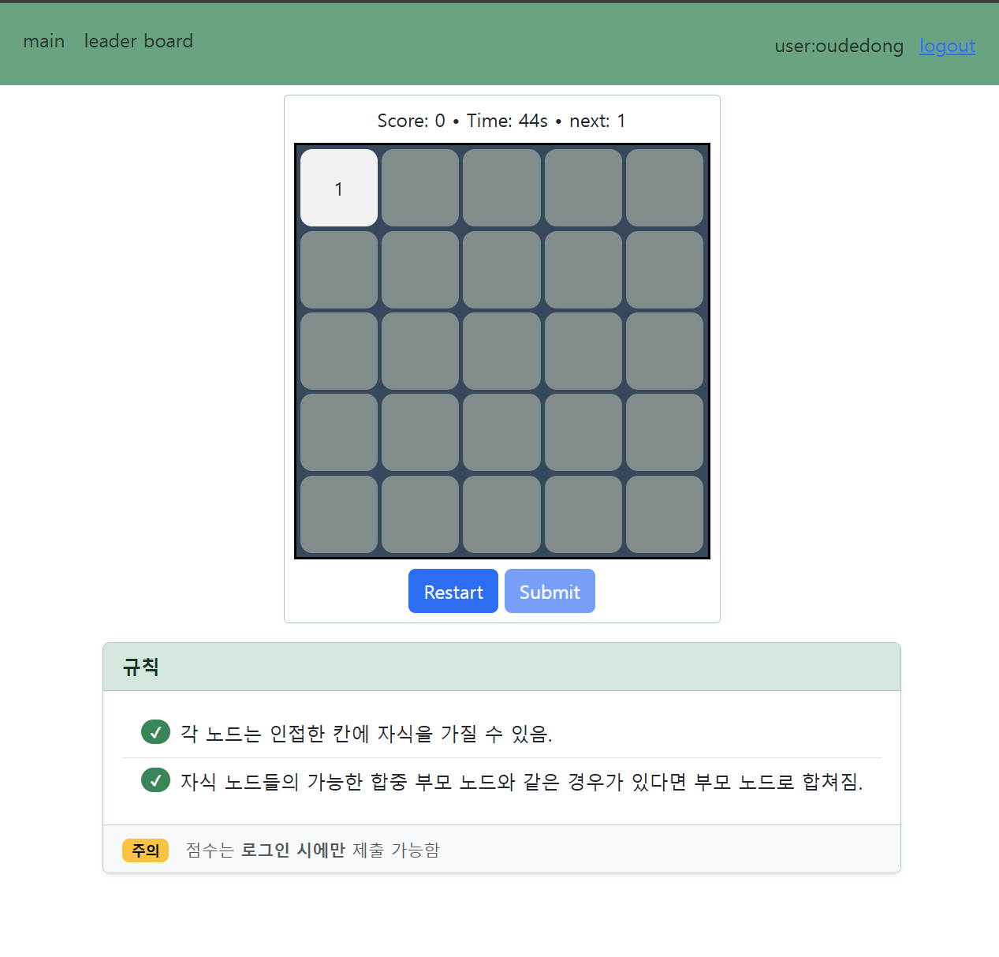
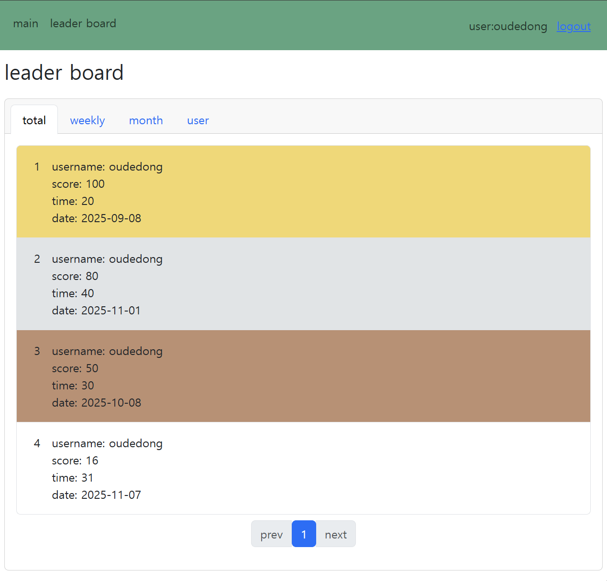
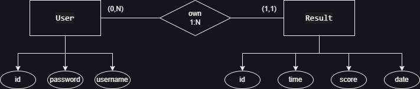

# Tree Puzzle: Django + MySQL 웹 퍼즐 게임

> 브라우저에서 바로 즐기는 퍼즐 게임과 기간별·유저별 리더보드.
> 클라이언트가 보낸 점수를 그대로 믿지 않고, **서버가 게임 전체를 다시 재현해 검증한 뒤 저장**합니다.

[데이터베이스 과목] 개인 프로젝트 | 2025.09 ~ 2025.11
**배포**: https://oudedong.pythonanywhere.com

| 게임 화면 | 리더보드 |
|:---:|:---:|
|  |  |

<br>

## 주요 기능

- **퍼즐 게임**: 5×5 보드에서 숫자 노드를 이어 트리를 만들고, 자식 노드들의 합이 부모 값과 같아지면 합쳐서 더 큰 수를 만드는 게임
- **점수 제출 및 서버 검증**: 로그인한 사용자만 제출 가능하며, 서버가 게임 기록을 처음부터 재현해 조작 여부를 확인
- **리더보드**: 전체 / 주간 / 월간 / 유저별 최고 기록 탭, 페이지네이션
- **회원가입 · 로그인 · 로그아웃**: Django 인증 시스템 기반 세션 로그인

<details>
<summary>게임 규칙 자세히 보기</summary>

1. 보드는 (0,0)에 값 1이 있는 상태로 시작합니다.
2. 매 턴 주어지는 값(`next`)을 기존 노드의 **인접한 빈칸**(8방향)에 놓으면 그 노드의 자식이 됩니다. 또는 같은 값을 가진 노드에 더할 수 있습니다.
3. 어떤 노드의 자식들 중 일부의 합이 그 노드의 값과 같아지면, 그 자식들은 사라지고 부모의 값이 두 배가 됩니다. 합쳐진 결과는 위쪽 부모로 연쇄적으로 이어질 수 있습니다.
4. 다음 값은 현재 최고 점수를 기준으로 난수로 정해지며, 보드가 가득 차면 게임이 끝납니다. 점수는 보드의 최댓값입니다.

</details>

<br>

## 기술 스택

| 구분 | 사용 기술 |
|---|---|
| 백엔드 | Python, Django 5.2 |
| 데이터베이스 | MySQL (Django ORM + 저장 프로시저), SQLite 지원 |
| 프론트엔드 | HTML, JavaScript, Bootstrap 5 |
| 배포 | PythonAnywhere |

<br>

## 핵심 구현

### 1. 서버 측 게임 기록 재현 검증

웹 게임은 점수를 브라우저에서 계산하기 때문에, 요청만 조작하면 원하는 점수를 리더보드에 올릴 수 있습니다.
이를 막기 위해 점수만 받지 않고 **게임 전체 기록**을 함께 받아 서버에서 다시 플레이해 봅니다.

```
클라이언트                                     서버
게임 시작: seed 생성 ─┐
매 턴: 행동 기록 ─────┼─▶ { seed, actions[], score, time }
게임 종료: 제출 ──────┘          │
                                 ├ 로그인 사용자와 제출자 일치 확인
                                 ├ 같은 seed로 난수 생성기 초기화
                                 ├ 행동을 한 턴씩 재현하며 규칙 검사
                                 │   - 그 턴에 주어진 값이 맞는지
                                 │   - 놓은 위치가 인접한 빈칸인지
                                 │   - 합치기 후 최고 점수가 일치하는지
                                 ├ 최종 점수 일치 확인
                                 └ 통과한 기록만 DB에 저장
```

- **같은 난수를 서버에서 재현**: 매 턴의 값은 난수로 정해지므로, 클라이언트의 시드 기반 난수 생성기(Mulberry32)를 Python으로 그대로 옮겼습니다. JavaScript의 32비트 부호 없는 정수 연산(`>>>`, `Math.imul`)을 Python에서 `& 0xFFFFFFFF`로 맞춰, 두 언어가 같은 시드에서 똑같은 수열을 만들도록 했습니다.
- **게임 로직의 순수 시뮬레이터**: 화면(DOM)과 분리된 보드·노드 시뮬레이터를 따로 만들어, 클라이언트 게임 로직과 1:1로 대응되도록 구현했습니다. (`core/valify2.py`)

### 2. 역할을 나눈 URL·API 설계

앱을 계정(`accounts`)과 게임(`core`)으로 나누고, 각 앱 안에서 **페이지를 반환하는 URL**과 **데이터를 주고받는 API**를 분리했습니다. API는 JSON으로 응답하며, 프론트엔드는 `fetch`와 CSRF 토큰으로 요청합니다.

| 구분 | 메서드 | URL | 설명 |
|---|:---:|---|---|
| 페이지 | GET | `/accounts/login/` | 로그인·회원가입 페이지 |
| API | POST | `/accounts/api/login/` | 로그인 |
| API | POST | `/accounts/api/logout/` | 로그아웃 |
| API | POST | `/accounts/api/register/` | 회원가입 후 자동 로그인 |
| API | GET | `/accounts/api/check/` | 현재 로그인 상태와 사용자 정보 |
| 페이지 | GET | `/main/` | 게임 페이지 |
| 페이지 | GET | `/main/leaderboard/` | 리더보드 페이지 |
| API | POST | `/main/api/submit` | 게임 기록 제출 (검증 후 저장) |
| API | GET | `/main/api/leaderboard` | 순위 조회 (`type`, `range`, `page`, `page_size`) |

### 3. DB 설계와 저장 프로시저



- `User`(Django 기본 사용자)와 `Result`(게임 기록)는 **1:N 관계**로, `Result`가 `user_id` 외래키를 가집니다.
- 리더보드 조회는 **MySQL 저장 프로시저**로 구현하고, 마이그레이션(`RunSQL`)에 포함해 `migrate` 한 번으로 테이블과 프로시저가 함께 생성되도록 했습니다.

| 프로시저 | 용도 | 구현 |
|---|---|---|
| `get_result_by_range(date_st, date_end)` | 전체·주간·월간 순위 | 기간 내 기록을 사용자명과 JOIN해 점수 내림차순, 같으면 소요 시간 오름차순 정렬. 기간이 비어 있으면 전체 기간 |
| `get_result_by_user()` | 유저별 최고 기록 순위 | 스칼라 상관 서브쿼리로 유저마다 최고 기록 1건의 id를 찾고, 이를 `Result`·`User`와 JOIN해 정렬 |

유저별 최고 기록은 점수가 같을 때를 대비해 **점수 → 소요 시간 → 날짜 → id** 순으로 우선순위를 정해, 유저당 정확히 한 건만 선택되도록 했습니다.

**SQLite 지원**: 저장 프로시저가 없는 SQLite에서도 동작하도록, 프로시저 생성은 MySQL에서만 실행되게 하고 같은 결과를 내는 Django ORM 쿼리(`Subquery`, `OuterRef`로 구현한 상관 서브쿼리)를 함께 두었습니다. 접속한 DB 종류에 따라 자동으로 프로시저 또는 ORM 쿼리를 사용합니다.

```sql
SELECT u.username, r.*
FROM core_result r
JOIN (
    SELECT cr.user_id, (
        SELECT x.id FROM core_result x
        WHERE x.user_id = cr.user_id
        ORDER BY x.score DESC, x.time ASC, x.date DESC, x.id DESC
        LIMIT 1
    ) AS best_id
    FROM core_result cr
    GROUP BY cr.user_id
) b ON r.id = b.best_id
JOIN auth_user u ON u.id = r.user_id
ORDER BY r.score DESC;
```

### 4. 배포

- 처음에는 PythonAnywhere에 Django 앱과 MySQL을 함께 배포해 운영했습니다. 이후 PythonAnywhere 무료 요금제에서 MySQL 제공이 중단되어, SQLite로 동작하도록 수정해 다시 배포했습니다.
- `SECRET_KEY`, `DEBUG`, `ALLOWED_HOSTS`, DB 종류와 접속 정보는 `.env` 환경 변수로 분리해, 코드 수정 없이 로컬과 배포 환경, MySQL과 SQLite를 전환할 수 있게 했습니다.

<br>

## 트러블슈팅: 정상적인 플레이가 검증에서 거절되는 문제

**문제**
특정 상황에서 정상적으로 플레이한 기록이 서버 검증을 통과하지 못했습니다.

**원인**
같은 값을 가진 노드에 값을 더했을 때, 합치기 검사를 **부모 노드에만** 하고 있었습니다. 값이 바뀐 노드 자신에게 자식이 있으면 그 자식들과 합쳐질 수 있는데, 이 경우를 놓치고 있었습니다. 게임 로직이 클라이언트(JavaScript)와 서버(Python)에 따로 있어서, 한쪽의 규칙이 어긋나면 결과가 달라졌습니다.

**해결**
- 클릭한 노드에 자식이 있으면 자기 자신부터, 없으면 부모부터 합치기를 검사하도록 클라이언트와 서버를 함께 수정했습니다.
- 이후 서버 검증 코드를 클라이언트 로직과 1:1로 대응되는 시뮬레이터로 새로 작성해(`valify.py` → `valify2.py`), 두 쪽의 동작이 어긋나지 않도록 했습니다.

<br>

## 프로젝트 구조

```
├── tree_puzzle/            # 프로젝트 설정 (settings, 최상위 URL)
├── accounts/               # 회원가입·로그인·로그아웃
│   ├── routes/web.py       #   페이지 URL
│   ├── routes/api.py       #   API URL
│   └── views.py
├── core/                   # 게임·리더보드
│   ├── routes/web.py
│   ├── routes/api.py
│   ├── views.py            #   점수 제출, 리더보드 API
│   ├── models.py           #   Result 모델
│   ├── valify2.py          #   서버 측 게임 재현 검증
│   ├── migrations/         #   스키마 + 저장 프로시저
│   └── static/core/js/     #   게임 로직(main2.js), 리더보드
└── static/js/common.js     # CSRF 토큰 처리
```

## 실행 방법

```bash
pip install -r requirements.txt
```

1. 프로젝트 루트에 `.env` 파일을 만들고 환경 변수를 설정합니다.
   ```
   SECRET_KEY=...
   DEBUG=1

   # SQLite (기본값): 별도 설정 없이 db.sqlite3 파일 사용
   DB_ENGINE=sqlite

   # MySQL을 쓰려면 아래처럼 설정 (저장 프로시저 사용, mysqlclient 필요)
   # DB_ENGINE=mysql
   # DB_NAME=...
   # DB_USER=...
   # DB_PASSWORD=...
   # DB_HOST=...
   ```
2. `python manage.py migrate` (테이블 생성, MySQL이면 저장 프로시저도 함께 생성)
3. `python manage.py runserver`

<br>

## 회고 및 개선 방향

- **시드를 서버에서 발급하기**: 현재는 시드를 클라이언트가 만들기 때문에, 규칙은 지키되 유리한 시드가 나올 때까지 다시 시작하는 것은 막지 못합니다. 서버가 게임 시작 시 시드를 발급하고 세션에 저장한 뒤, 제출 시 대조하면 이 부분까지 막을 수 있습니다.
- **소요 시간 검증**: 점수와 달리 소요 시간은 클라이언트가 보낸 값을 그대로 저장합니다. 게임 시작 시각을 서버에서 기록하고 게임오버시 서버로 자동으로 제출하게 하면 서버에서 소요시간을 계산할 수 있을 것 같습니다.
